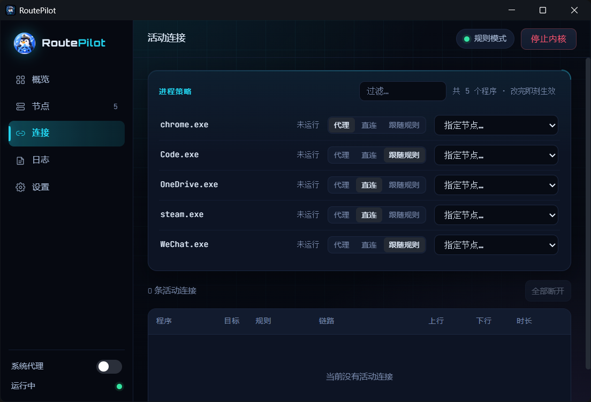
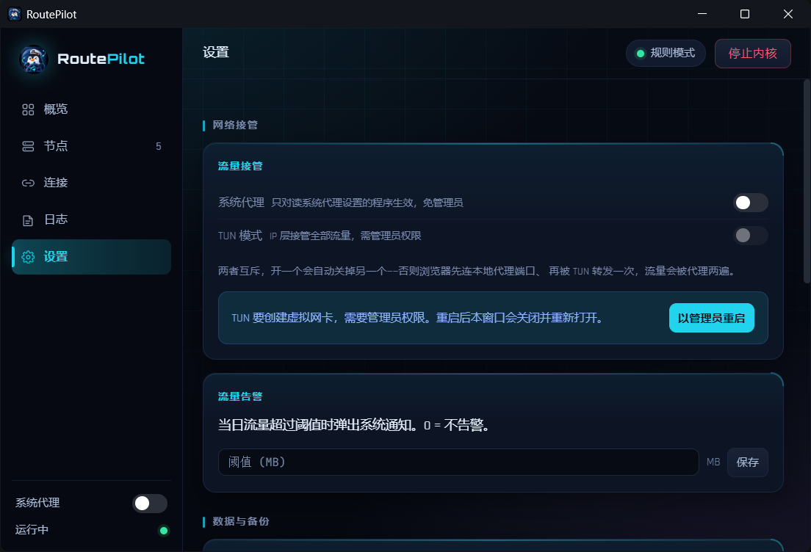

# NexusLink

[](https://github.com/peican996/nexuslink/actions/workflows/ci.yml)
[](https://github.com/peican996/nexuslink/releases)
[](LICENSE)

> 一个把**「按程序分流」**做到位的代理控制台。Go + Wails v3 + React，内核复用 [mihomo](https://github.com/MetaCubeX/mihomo)。

**English TL;DR** — NexusLink is a Windows desktop proxy console built with Go + Wails v3 + React, wrapping the mihomo core. Unlike generic Clash GUIs that route by domain only, it exposes **per-process routing** as a first-class feature: every connection is tagged with its owning process, and you can pin any program to "always direct" or "always proxy". Licensed GPL-3.0.

---

## 为什么做这个

现成的 Clash 客户端都只认域名和 IP。但真实需求经常是**程序维度**的：

- 某个同步工具必须走直连，否则一直触发风控
- 游戏客户端不能过代理，否则掉线
- 而浏览器、终端又必须走代理

NexusLink 把进程名直接暴露到界面上：连接列表带进程、进程策略三态（代理 / 直连 / 跟随规则），改完立刻生效，不用重启内核。

## 功能

| 模块 | 能力 |
|---|---|
| **进程分流** | 连接列表按进程聚合，单程序三态策略，改动热生效；内核以 `find-process-mode: always` 运行 |
| **接管方式** | 系统代理（免管理员）与 TUN（IP 层，需管理员）二选一，互斥切换 |
| **模式切换** | 规则 / 全局热切换不断网；排查时可一键全部直连 |
| **订阅** | 多订阅并存、切换、自动更新；支持 Clash YAML 与 base64 / 明文节点列表；每个订阅可单独决定是否跳过证书校验，并常驻提示 |
| **节点** | 批量测速、单点测速、收藏、延迟趋势 |
| **地图** | 节点全球分布、当前出口、连接落点，可配置本机位置 |
| **流量** | 实时速率、24 小时曲线、当日用量告警 |
| **连接** | 目标 / 规则 / 链路 / 时长 / 上下行，单条或全部断开 |
| **日志** | 增量拉取、关键词与级别过滤、导出 |
| **内核升级** | 从 GitHub release 拉取，域名白名单 + 摘要校验后再替换 |
| **运维** | 开机自启（管理员下用计划任务，TUN 可静默随开机启动）、托盘状态灯、单实例、崩溃自愈、配置导入导出 |

## 使用指导

完整图文步骤见 **[docs/usage.md](docs/usage.md)**：添加订阅、选模式、开系统代理 / TUN、按程序分流、排障与卸载。两张关键界面：

**按程序分流**（本项目的重点能力）——每个程序单独指定「代理 / 直连 / 跟随规则」，改完即刻生效：



**流量接管**——系统代理（免管理员）与 TUN（IP 层接管全部程序，需管理员）二选一：



## 技术栈

- **后端**：Go 1.26、Wails v3、Windows 注册表 / Job Object / UAC
- **前端**：React 18、TypeScript、Vite、纯 SVG 图表（不引图表库）
- **内核**：[mihomo](https://github.com/MetaCubeX/mihomo)（独立进程，通过外部控制 API 通信）

## 快速开始

### 环境

- Windows 10/11 x64
- Go **1.26+**
- Node.js **20.19+**
- Wails v3 CLI：`go install github.com/wailsapp/wails/v3/cmd/wails3@latest`

### 准备内核与数据

`assets/` 下的第三方二进制合计约 71MB，不进版本库，缺了会编译失败（`go:embed` 要求文件存在）：

```bash
# 直接按 assets/manifest.json 里的地址下载，逐个校验 sha256（推荐）
python scripts/fetch-assets.py --download

# 从已有的一份构建复制（换机器、断网时最快）
python scripts/fetch-assets.py --from-dir /path/to/another/checkout/assets
```

版本、下载地址与哈希都记录在 `assets/manifest.json`，来源见 `THIRD_PARTY_NOTICES.md`。geo 数据跟随上游 `latest`，哈希只作为当初取用时的快照，校验按告警处理。

### 构建

```bash
# 前端
cd frontend && npm install && npm run build && cd ..

# 打包（会重建前端并生成便携 zip 到 release/）
python package.py 1.0.0
```

产物：`bin/NexusLink.exe`、`release/NexusLink-v1.0.0-win64-portable.zip`。
也可以直接跑 `.\build.ps1`。

发版走 CI：把 tag 推上去（`git tag v1.0.0 && git push --tags`），`.github/workflows/release.yml` 会重新拉资源、构建、算好 sha256 并挂到 Release 页。构建好的版本也可以直接从 [Releases](https://github.com/peican996/nexuslink/releases) 下，不用自己编。

### 开发

```bash
cd frontend && npm run dev     # 前端热更新
wails3 dev                     # 后端 + WebView 联调
```

## 目录结构

```
.
├── main.go                 # 入口：单实例、托盘、窗口、事件注册
├── service.go              # 核心服务层（订阅/内核/代理/规则/流量）
├── internal/
│   ├── kernel/             # mihomo 进程管理与外部控制 API 客户端
│   ├── configgen/          # 订阅配置改写（注入进程分流规则）
│   ├── subscription/       # 订阅拉取与解析
│   ├── sysproxy/           # 系统代理设置与还原
│   ├── elevate/            # 管理员权限检测与提权
│   └── autostart/          # 开机自启
├── frontend/src/
│   ├── App.tsx             # 骨架 + 状态编排
│   ├── api.ts              # 后端调用入口
│   ├── components/         # 各面板（设置/节点/连接/日志/概览/侧栏/顶栏）
│   ├── NodeMap.tsx         # 地图视图
│   └── TrafficChart.tsx    # 流量曲线
├── assets/                 # 内嵌资源（二进制不进库，见 manifest.json）
└── scripts/
```

## 数据目录

```
%APPDATA%\NexusLink\
├── config.yaml              # 由订阅生成的运行时配置
├── subs.json / sub-*.yaml   # 多订阅列表与各订阅原文
├── sub-*.provider.yaml      # base64 订阅解码后的节点列表（给内核 provider）
├── app-state.json           # 模式、TUN、窗口位置、本机坐标
├── proxy.json               # 接管系统代理前的原始设置
├── process-rules.json       # 进程分流规则
├── process-direct.yaml / process-proxy.yaml  # 进程规则 provider
├── process-ignored.json     # 用户选择不再提示的进程
├── traffic-history.json     # 分钟级流量历史（保留 7 天）
├── geoip.metadb / geosite.dat  # 内置地理数据
├── debug.log / kernel.log   # 运行日志
└── bin\                     # 释放出来的内核与 wintun.dll
```

旧版本（`ProxDeck`）的数据会在首次启动时自动迁移。

## 隐私

- 无遥测、无统计上报、无账号体系
- 除订阅地址、内核升级检查、代理链路健康检查和节点测速外，不主动发起网络请求
- 健康检查与测速会按当前模式请求固定的 `generate_204` 端点，用于判断链路是否可用
- 订阅、规则、历史全部保存在本机 `%APPDATA%`，不上传
- GeoIP 查询使用内置离线数据库，不依赖在线接口

## 许可

本项目以 **GPL-3.0** 发布，全文见 [LICENSE](LICENSE)。

选 GPL-3.0 而非 MIT 的原因：本项目内嵌并分发 [mihomo](https://github.com/MetaCubeX/mihomo)（GPL-3.0）与 [wintun](https://www.wintun.net/)（GPL-2.0）二进制，采用同族许可最清晰。第三方组件的来源、版本与许可证见 [THIRD_PARTY_NOTICES.md](THIRD_PARTY_NOTICES.md)。

## 免责声明

本项目只提供代理**客户端**，不提供任何代理服务、节点或订阅。软件按「现状」提供，不附带任何担保；使用前请自行确认所在地区的法律法规与网络服务条款，因使用产生的后果由使用者自行承担。

## 贡献

欢迎提 Issue 与 PR，动手前请先读 [CONTRIBUTING.md](CONTRIBUTING.md)。安全问题请按 [SECURITY.md](SECURITY.md) 私下报告，不要开公开 Issue。

## 致谢

- [mihomo](https://github.com/MetaCubeX/mihomo) — 内核
- [meta-rules-dat](https://github.com/MetaCubeX/meta-rules-dat) — GeoIP / GeoSite 数据
- [wintun](https://www.wintun.net/) — TUN 虚拟网卡
- [Wails](https://wails.io/) — Go 桌面框架
