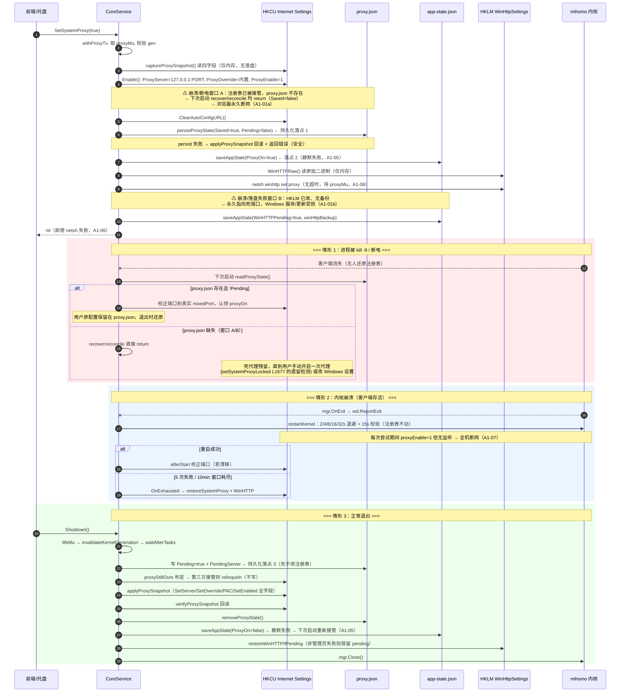
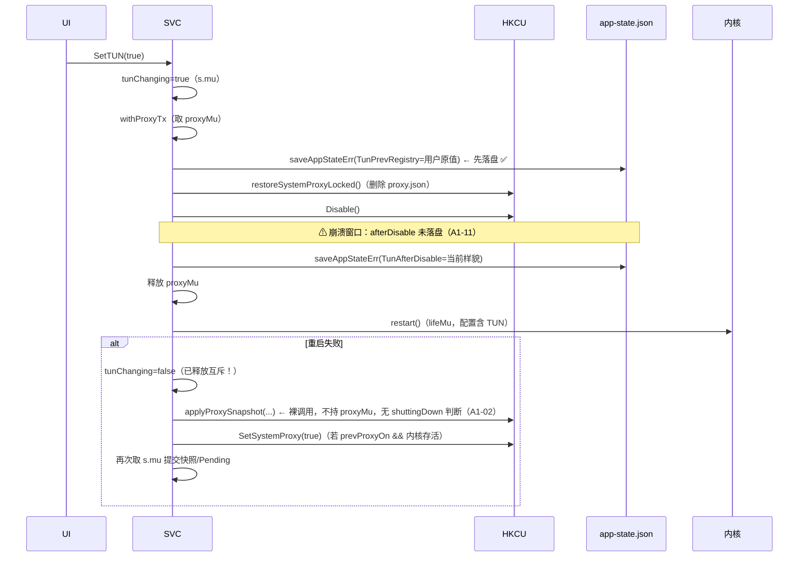

# RoutePilot 审计报告 · 子 Agent 1：Windows 系统代理与 WinHTTP 专项

## 1. 头部

### 1.1 审计范围
- HKCU `Internet Settings`（WinINET 系统代理）的接管 / 还原 / 崩溃恢复 / 外部改动判定。
- HKLM `Internet Settings\Connections\WinHttpSettings`（WinHTTP）的备份 / 接管 / 还原。
- 系统代理与 TUN 两条接管路径的互斥与交错。
- 相关的持久化（`proxy.json`、`app-state.json`）与故障窗口。

### 1.2 基线
- 提交：`39ca02c1aa9303fc14fe8264d2715432cd50f030`（`gofmt: 对齐测试表字段`），工作区干净。
- 基线事实（主控已实测，本报告未重跑）：`go build ./...` / `go vet ./...` / `go test -count=1 ./...` 全绿。

### 1.3 审阅文件清单（实际 Read 全文或指定区间）
| 文件 | 行数 | 说明 |
|---|---|---|
| `internal/sysproxy/sysproxy_windows.go` | 275 | 全文 |
| `service.go` | 6054 | 重点区间 L1-360、L560-840、L1110-1520、L1560-2700、L4005-4055、L5283-5445 |
| `c1_proxy_test.go` | 417 | 全文相关部分 |
| `c1_1_proxy_test.go` | 111 | 全文 |
| `c1_1_r1_proxy_test.go` | 535 | 全文相关部分 |
| `c5_tun_proxy_test.go` | 368 | 头部与关键用例 |
| `c5_1_proxy_test.go` | 335 | 函数名清单 + 关键用例 |
| `startup_restore_plan_test.go` | 61 | 函数名 |
| `internal/sysproxy/sysproxy_windows_test.go` | 177 | 函数名 + WinHTTP 用例 |
| `c4_tun_test.go` | 250 | 函数名 + 并发拒绝用例 |
| `c3_persist_test.go` | 55 | 函数名 |
| `main.go` | 513 | 托盘 / 退出接线（L370-410、L180、L274-278、L458） |
| `frontend/src/App.tsx` | 1337 | 仅确认入口（L398、L420、L857） |

> 说明：任务书提到的 `repro_persist_test.go` 在基线中不存在；实际为 `c3_persist_test.go`（订阅落盘，与本专项无关）与 `repro_t12_test.go`。

### 1.4 实际执行过的命令
- `git log -1 --format='%H %s'`、`git status --porcelain` → 确认基线与干净工作区。
- `wc -l` / `ls` → 确认文件与行数。
- `grep`（Grep 工具 / bash grep）复核：`systemProxyOps` 全部方法、`saveAppState*`、`proxyMu/lifeMu`、`SetSystemProxy|SetTUN|WinHTTP` 的调用点、测试函数清单、`failEnable` 是否被使用。
- 未执行任何测试（基线已绿），未访问网络，未修改任何 .go/.ts/配置文件。

### 1.5 结论摘要
| 等级 | 数量 | 编号 |
|---|---|---|
| P0 | 0 | — |
| P1 | 1 | A1-01 |
| P2 | 7 | A1-02 ~ A1-08 |
| P3 | 4 | A1-09 ~ A1-12 |

一句话结论：本专项的**恢复事务**（Pending 落盘 → 写注册表 → 回读校验 → 删备份）设计成熟、测试覆盖到位；**接管事务**没有采用同一套"先持久化"模式，`proxy.json` 与 WinHTTP 备份都在注册表已被改写之后才落盘，这是本专项唯一的高危缺口（A1-01），也是 8 个问题中 Q1/Q2 的答案。TUN 与系统代理的互斥在主路径上是正确的，但 TUN **切换失败的回滚分支**跑在 `proxyMu` 之外，是次级风险集中地（A1-02/A1-03）。

---

## 2. 八个必答问题的直接回答

| # | 问题 | 结论 | 依据 |
|---|---|---|---|
| Q1 | 是否**先**持久化原始快照，**再**修改系统代理？ | **否，顺序是反的**。系统代理：`Enable()` 写注册表(L1689) → 清 PAC(L1696) → `persistProxyState`(L1707)。WinHTTP：读备份只进内存(L1965) → `netsh` 改 HKLM(L1970) → `saveAppState`(L1979)。**只有 TUN 路径做对了**（L2266 先 `saveAppStateErr` 再改注册表）。顺序错的后果见 A1-01。 | `service.go:1689/1707/1948-1980` |
| Q2 | 接管后崩溃（power loss / kill -9），下次启动能否恢复？靠什么状态标识？ | **分三种情况**：① `proxy.json` 已落盘（`Saved=true,Pending=false`）→ 能识别为"我方接管"，`reconcileProxyLocked` 校正端口并恢复 `proxyOn`，退出时正常还原；② 恢复进行中崩溃（`Saved=true,Pending=true`）→ `recoverPendingProxyRestore` 优先重试，幂等；③ **在 `Enable()` 与 `persistProxyState()` 之间崩溃 → 无任何标识**，`readProxyState` 返回零值，`recover`/`reconcile` 双双 return，注册表永久停在 `127.0.0.1:PORT` 死代理上。WinHTTP 只有 `app-state.json` 一份标识，且写入晚于 `netsh`，同样存在无标识窗口。 | `service.go:1295-1318`、`2099-2126`、`1948-1980` |
| Q3 | 恢复成功但 app-state 保存失败，会不会出现"注册表已还原 + 状态文件仍标记待恢复"？reconcile 怎么处理？ | **反向不一致已被正确处理**：删 `proxy.json` 失败时返回错误并保留 `Pending`，下次启动重试是幂等且安全的（`TestR1RemoveFailureKeepsMemoryBackup`）。**正向不一致没被处理**：`saveAppState()` 静默吞错(L1908)，磁盘仍是 `ProxyOn=true`，下次启动 `restoreProxy=true` 又重新接管——但此时 `proxy.json` 已删，`recoverPendingProxyRestore` 不介入，属于"擅自重新开启"。见 A1-05。另有 A1-04：删备份失败时内存 `proxyOn` 未回滚。 | `service.go:1899-1908`、`5378-5382`、`5323` |
| Q4 | 用户手动改代理 / 另一款代理接管后，会不会被陈旧快照覆盖？`proxyStillOurs` / `tunRestoreUserChanged` 够不够？ | 主路径够用：地址被改成任意第三个值 → `relinquish`，不写注册表（`TestT16`/`TestR1ExternalChangeAfterFailedRestoreIsNotOverwritten`）。TUN 侧的字段级 `tunRestoreUserChanged` 比单纯比地址更严，逐字段比对且允许 `Want/Begin` 两个值，覆盖 PAC-only、Override-only 的改动。**两个语义边界**：① `cur==""` 一律判为"我方"（L1916）→ 用户清空地址的场景会被写回旧值（P3，A1-10 附述）；② `tunRestoreUserChanged` 只在 `Pending` 重试分支生效，首次尝试走 `afterDisable` 全等比对（正确）。真正的问题是 A1-03：并发时 `tunPrevRegistry` 可能把**我们自己的端口**记成"用户原始配置"。 | `service.go:1915-1925`、`2617-2652`、`2546-2588` |
| Q5 | TUN 与系统代理会不会同时接管？互斥在哪一层？ | 正常运行期**不会**。三层互斥：`setSystemProxyLocked` 在 `proxyMu` 内读 `tunOn/tunChanging` 拒绝(L1656-1668)；`reconcileProxyLocked` 遇 `tunChanging` 或 `TUNState()` 直接 return(L2100-2110)；`setTUN` 在改注册表前先置 `tunChanging=true`(L2237)。**缺口**在 TUN 切换**失败后的回滚分支**：L2366 已把 `tunChanging` 置 false，随后 L2389/2395/2401 的 `applyProxySnapshot` **不持 `proxyMu`**，也没有 `IsShuttingDown()` 判断 → 可与用户操作/Shutdown 交错（A1-02），也见 A1-11 的崩溃窗口。 | `service.go:1656-1668`、`2100-2110`、`2237`、`2361-2428` |
| Q6 | 内核退出后是否遗留失效代理、用户是否彻底断网？谁兜底、超时多久？ | 会。`restartKernel` 不碰注册表，内核崩溃到重启成功（或放弃）期间系统代理始终指向已死端口。兜底只有 `Watchdog.OnExhausted`(L2915)：窗口 10min、最多 5 次、退避 2/4/8/16/32s、每次启动校验 15s → **最坏约 2–2.5 分钟**整机（浏览器/WinINET 程序）断网后才还原。若**本进程被杀且不再启动**，Windows 侧没有任何兜底 → 无限期断网，直到用户手动改注册表或再次启动本程序。见 A1-07。 | `service.go:2879-2952`、`1519-1565` |
| Q7 | 注册表部分成功（ProxyServer 写成、ProxyEnable 写失败）怎么回滚？`applyProxySnapshot` 覆盖全字段吗？ | 覆盖全字段：`SetServer` / `SetOverride` / `SetAutoConfigURL`|`ClearAutoConfigURL` / `SetEnabled`，顺序合理（Enable 最后），由 `verifyProxySnapshot` 回读兜底。**问题在调用方**：接管路径的三处回滚全部写成 `_ = s.applyProxySnapshot(bk)`(L1691/1697/1704/1708)，回滚失败不记录、不上报 → 可能出现"半接管且无任何痕迹、无备份文件"（A1-09）。另外 `ProxyOverride` 用 `SetStringValue` 写回，原值"不存在"会被替换成"存在但为空串"（A1-10）。 | `service.go:1768-1794`、`1689-1710`、`sysproxy_windows.go:104-120/157-168` |
| Q8 | 管理员权限丢失（HKLM / netsh 失败）时有降级吗？会强行写 HKCU 吗？会把部分接管误报为成功吗？ | 不会强行写 HKLM（写好的是 HKCU，本来就不需要管理员）。**但会把部分接管误报为成功**：`takeOverWinHTTP` 对"非管理员 / HKLM 打不开 / netsh 失败"一律只 `s.dbg`，`setSystemProxyLocked` 仍 `return nil`(L1719)，UI 全程无提示，`winHTTPPending` 也没置位 → 用户以为服务流量也走代理，实际没有，且这次失败**没有留下任何可供下次重试的依据**。见 A1-06。 | `service.go:1948-1980`、`1717-1719` |

---

## 3. 问题清单

### A1-01 · P1 · 接管事务"先改注册表、后持久化快照"，崩溃/落盘失败即永久失去还原依据
| 字段 | 内容 |
|---|---|
| 文件 | `service.go` |
| 函数 | `setSystemProxyLocked` + `takeOverWinHTTP` |
| 代码位置 | `L1689` `ops.Enable(addr)`；`L1696` `ClearAutoConfigURL`；`L1707` `persistProxyState(bk)`；`L1711-1715` 内存提交；`L1965-1980` WinHTTP：`WinHTTPRaw`(读) → `EnableWinHTTP`(L1970, 改 HKLM) → `saveAppState`(L1979，失败仅 dbg) |
| 问题描述 | 快照（`captureProxySnapshot` 的结果）在被修改前**只存在于内存**，`proxy.json` 的写入发生在注册表已被改写之后；WinHTTP 的原始二进制值同样只存在于内存，且在 `netsh` 已改写 HKLM 之后才随 `app-state.json` 落盘，落盘错误被 `saveAppState` 吞掉。两个子表现同源：(a) HKCU 侧崩溃窗口无标识；(b) HKLM 侧落盘失败是**确定性**丢失。 |
| 触发条件 | (a) 注入点：`fakeRegistry.enableHook` 返回后、`persistProxyState` 之前 kill 进程（真机：电源丢失 / 任务管理器结束进程 / BSOD）。重启后 `readProxyState` 读不到文件。 (b) 注入点：`appStateWriter = func(...) error { return syscall.ENOSPC }`，管理员下点"开启系统代理"。 |
| 实际影响 | (a) 注册表停在 `ProxyEnable=1, ProxyServer=127.0.0.1:17890`，`proxy.json` 不存在。下次启动：`recoverPendingProxyRestore` 因 `Saved=false` 直接返回(L1304)；`reconcileProxyLocked` 同样因 `!st.Saved` 返回(L2117)；`restoreProxy` 取自 app-state（此时仍为 false）。→ **浏览器与所有 WinINET 程序在下次启动本程序前全部断网**；若未配置开机自启/用户不再启动，则永久残留。(b) HKLM `WinHttpSettings` 永久指向 `127.0.0.1:17890`，**即便卸载本程序也不会恢复**，破坏 Windows Update / 微软商店 / 依赖 WinHTTP 的系统服务；同时 `winHTTPPending` 丢失，后续再无任何还原依据。 |
| 根因 | 接管路径没有复用恢复路径已经验证过的"Pending 先落盘"协议。TUN 路径的前置操作（L2258-2271）恰恰是先 `saveAppStateErr` 再动注册表，说明团队已知该模式，但系统代理/WinHTTP 接管未迁移。 |
| 修复建议 | 接管前先写一份**预备份**：`bk` 以 `Pending=true` 落盘（语义为"即将接管/接管中"），成功后再改写为 `Pending=false`；`persist` 失败即拒绝接管并返回错误（与 TUN 的 `errTUNSnapshotSaveFailed` 对齐）。WinHTTP 同理：先把 `raw` + `addr` 落盘并置 `winHTTPPending=true`，再 `netsh`；`saveAppStateErr` 失败则**不执行** `netsh`。启动时把 `Pending=true && 无注册表接管特征` 也纳入恢复判定。 |
| 测试方案 | ① 用现有 `enableHook` 断言"进入 `Enable` 时 `proxy.json` 已存在且 `Pending=true`"（现状必然失败）；② 构造 crash：hook 内记录后 `newC1Service` + 同目录重建服务实例、fake 保持 `written=true/server=addr/enabled=true`，断言 `recoverPendingProxyRestore` 能把注册表还原为用户原值；③ `appStateWriter` 注入 ENOSPC，断言 `EnableWinHTTP` **未被调用**且 `SetSystemProxy(true)` 返回错误；④ 成功后断言 `proxy.json` 中 `Pending=false`、`Saved=true`。 |
| 置信度 | 高（顺序为代码事实；(a) 影响需崩溃命中毫秒级窗口，(b) 为确定性） |
| 备注 | 修复后需同步更新 `TestT01CrashRecoveryRestoresOriginal` 的前提语义（"Pending"从"恢复中"扩展为"接管中/恢复中"）。 |

### A1-02 · P2 · TUN 切换失败的回滚分支在 `proxyMu` 之外写注册表，且已提前释放 `tunChanging`
| 字段 | 内容 |
|---|---|
| 文件 | `service.go` |
| 函数 | `setTUN`（`restart()` 失败分支） |
| 代码位置 | `L2366` `s.tunChanging = false`；`L2387` `s.SetSystemProxy(true)`（自有锁）；`L2389`、`L2395`、`L2401` 三处 `s.applyProxySnapshot(...)` **裸调用**；`L2408` 再取 `s.mu` 提交快照状态 |
| 问题描述 | 失败分支在进入注册表回滚前就把 `tunChanging` 置 false，且回滚期间的 `applyProxySnapshot` 完全绕过 `proxyMu`，也没有 `IsShuttingDown()`/`Quitting()` 判断。文中 L2221 的注释明确写着"注册表部分在 proxyMu 内完成"，此分支是例外。 |
| 触发条件 | 注入点：`restart` 返回 error（用 `setTUN(on, func() error { return err })`），在 `L2389` 之前插入 barrier；并发调用 `SetSystemProxy(true)`（模拟用户点开关）；或并发 `Shutdown()`。 |
| 实际影响 | 三种走法：① 用户 `Enable(17890)` 先写、回滚 `applyProxySnapshot(prevBackup)` 后写 → 用户的开启动作被静默抹掉，但 `s.proxyOn` 仍被置 true（L2371 之前/`SetSystemProxy` 自己置的）→ UI 显示已开启、注册表已关闭，且 `proxy.json` 处于 Saved 状态，端口漂移时 `updateSystemProxyPort` 会把代理**重新写回**；② 与 `Shutdown` 交错：`Shutdown` 先完成还原、`setTUN` 的回滚随后把接管值写回注册表 → **进程退出时留下指向死端口的系统代理**（且 `proxy.json` 可能已被删，下次启动无标识，退化为 A1-01(a)）；③ 回滚期间的 `applyProxySnapshot` 与 `SetSystemProxy` 的 `captureProxySnapshot` 交错 → 捕获到半回滚状态当作"用户原始配置"。 |
| 根因 | 失败分支把"状态提交"（内存）放在"副作用回滚"（注册表）之前，且回滚未纳入事务锁；`clearChanging` 的位置假设了"失败即无并发"，与并发模型不符。 |
| 修复建议 | 把整个失败分支（含 `SetSystemProxy(true)` 与三处 `applyProxySnapshot`）包进 `s.withProxyTx(0,nil,...)`，并在 `tunChanging=false` 之前完成注册表回滚；`tunChanging` 只在回滚落地后清。回滚前加 `if s.IsShuttingDown() { 保留 Pending 快照，直接返回 }`。 |
| 测试方案 | ① barrier 在 `applyProxySnapshot` 前，另一 goroutine 调 `SetSystemProxy(true)`，断言最终注册表 == `127.0.0.1:17890` 且 `s.proxyOn == true`（或二者同为 false），杜绝"UI 与注册表不一致"；② barrier 在回滚前，主 goroutine 调 `Shutdown()`，断言退出后 `fake.server != "127.0.0.1:17890"`；③ 断言整个失败分支执行期间 `proxyMu` 被持有（在回滚里 `TryLock` 必须失败）。 |
| 置信度 | 高（对锁与顺序的判断是代码事实）；并发命中概率中 |

### A1-03 · P2 · `setTUN` 的前置快照在锁外读取且事务内不重校验，并发开代理会把"我方端口"记成"用户原始配置"
| 字段 | 内容 |
|---|---|
| 文件 | `service.go` |
| 函数 | `setTUN` / `setSystemProxyLocked` |
| 代码位置 | `L2239-2243` 读 `prevTUN/prevProxyOn/prevBackup/prevTunPrevProxy`（仅 `s.mu`）；`L2252` 才进入 `withProxyTx`；`L2257-2260` `previousRegistry = prevBackup; if !Saved { captureProxySnapshot("") }`；`L2277` `if prevProxyOn || prevBackup.Saved`；`L2469-2474` / `L2502-2503` 关 TUN 时使用 `prevRegistry` |
| 问题描述 | `prevProxyOn/prevBackup` 是"决定 TUN 前置动作"的输入，但它们是在 `proxyMu` 之外取的快照，进入事务后不再复核 `s.proxyOn/s.backup`。若在两者之间有一次 `SetSystemProxy(true)` 成功提交，事务看到的仍是旧值：`prevProxyOn=false && prevBackup.Saved=false` → 跳过 `restoreSystemProxyLocked` → 直接 `Disable()`；此时注册表里是**我方端口**，`captureProxySnapshot("")` 把这个值写进 `tunPrevRegistry` 当作"用户原始配置"，并且 `proxy.json`（Saved=true）留在磁盘上未清理。 |
| 触发条件 | 并发时序（全部有注入点）：`SetTUN(true)` 执行到 `L2243` 后插入 barrier → 另一 goroutine 完成 `SetSystemProxy(true)`（`proxyMu` 空出即可）→ 放行。用户侧表现为"快速连点 TUN 与系统代理开关"或前端两个事件同时触发（`App.tsx:398/420`）。 |
| 实际影响 | 关 TUN 时 `restoreTunExternalProxyLocked(prev=tunPrevRegistry{Server:"127.0.0.1:17890", Enabled:true})` 校验通过 → 写回并启用 **17890** → 用户从未设置过的系统代理在"关闭 TUN"之后被打开；`proxy.json` 残留使 `reconcileProxy` 在下次启动继续认领。属于"配置被悄悄改写"，不是断网。 |
| 根因 | 事务的前置条件（是否已有我方接管、原始配置是什么）在进入事务前计算，事务内不可变；`proxyMu` 只保护写，不保护"读-判定-写"的整体。 |
| 修复建议 | 把 `prevProxyOn/prevBackup` 的读取移到 `withProxyTx` 内部（进入锁后再取 `s.proxyOn/s.backup`），或在锁内重读并校验与事务外快照一致，不一致则返回"状态已变化，请重试"。`captureProxySnapshot` 取到的 `Server` 若等于当前 `127.0.0.1:<mixedPort>`，必须视为"我方接管"而不是用户原始值（可直接复用 `proxyStillOurs`）。 |
| 测试方案 | ① 按上述 barrier 并发，断言 `svc.tunPrevRegistry.Server != "127.0.0.1:17890"` 且 `proxy.json` 已被清理；② 关 TUN 后断言 `fake.enabled == 用户原值`（不是 true）；③ 用 `TestC51ReTakeoverPreservesOriginalFourFields` 的断言方式验证四字段仍来自真实原始值。 |
| 置信度 | 高（代码路径确定）；并发命中概率中低 |

### A1-04 · P2 · 恢复成功但删 `proxy.json` 失败时，内存 `proxyOn` 未回滚 → 端口校正会把代理重新写回
| 字段 | 内容 |
|---|---|
| 文件 | `service.go` |
| 函数 | `restoreProxyTransactionLocked` / `updateSystemProxyPort` |
| 代码位置 | `L1890` apply → `L1894` verify → `L1899-1901` `removeProxyState` 失败直接 `return err` → `L1904-1908`（提交内存）**未执行**；`L1736-1746` `updateSystemProxyPort` 依据 `s.proxyOn` |
| 问题描述 | 恢复已完整落地（注册表正确、回读校验通过），仅"删文件"失败；函数在提交内存前退出，`s.backup` 仍是 `Pending=true`、`s.proxyOn` 仍是 `true`。调用方 `setSystemProxyLocked(false)` 把错误抛给 UI，但没有回滚内存意图。 |
| 触发条件 | `removeProxyState` 注入失败（真机：`proxy.json` 被杀软/索引器/备份软件持有句柄，或目录只读），随后内核端口漂移或 `RestartKernel`（`afterStart` → `changed && proxyOn`）。 |
| 实际影响 | ① 用户点了"关闭系统代理"，UI 仍显示开启（`Status().ProxyOn` 来自 `s.proxyOn`），再次点开启被 `bk.Pending` 拒绝(L1669) → 用户无法恢复开关；② 内核重启且端口变化时 `updateSystemProxyPort` 检查 `proxyOn==true` → `Enable(新端口)` **把刚还原的注册表重新接管**，用户"关闭代理"的意图被反向执行；③ 下次启动 `recoverPendingProxyRestore` 会幂等重试，能自愈，故非永久。 |
| 根因 | "副作用已完成/本地依据未清除"这一中间态没有对应的内存回滚；`proxyOn` 语义混用了"注册表由我接管"和"用户意图"。 |
| 修复建议 | `removeProxyState` 失败时：保留 `Pending` 依据不变，但把 `s.proxyOn=false`（注册表事实上已不属于我方），并让 `updateSystemProxyPort` 的依据改为"`!backup.Pending && proxyOn`"。 |
| 测试方案 | 在现有 `TestRestoreSuccessRemoveFailureKeepsBackup` 基础上补断言：`svc.proxyOn == false`；再调 `svc.updateSystemProxyPort(0,nil,17891)`，断言 `fake.server` 仍是原值（现状会被改成 17891，测试应失败）。 |
| 置信度 | 高（代码事实）；触发概率低 |

### A1-05 · P2 · `saveAppState` 静默失败导致"关闭代理"意图丢失，下次启动擅自重新接管
| 字段 | 内容 |
|---|---|
| 文件 | `service.go` |
| 函数 | `restoreProxyTransactionLocked` / `saveAppState` / `loadAppState` |
| 代码位置 | `L1908` `s.saveAppState()`；`L5378-5382` 仅 `s.dbg`；`L5323` `s.restoreProxy = st.ProxyOn`；`L1221-1228` 启动时 `setSystemProxyForGeneration(true)` |
| 问题描述 | 关闭代理成功后，`ProxyOn=false` 只写内存与磁盘 app-state；落盘失败被吞。磁盘仍是 `ProxyOn=true`，而 `proxy.json` 已被删除，`recoverPendingProxyRestore` 不会介入。 |
| 触发条件 | `appStateWriter` 注入失败（真机：磁盘满、`%APPDATA%` 被占用/漫游目录不可写）。 |
| 实际影响 | 下次启动 `restoreProxy=true` → 自动重新接管系统代理，用户看到"我没开，它自己开了"。不造成断网（内核在跑），但属于未经用户同意的配置变更；若此时用户已改用别的代理软件，我方接管还会覆盖它（因为 `captureProxySnapshot` 会把对方的值当原始值保存）。 |
| 根因 | `ProxyOn` 这类"用户意图"没有可靠落盘保证，且没有任何"落盘失败"的可见信号。 |
| 修复建议 | 关闭代理路径改用 `saveAppStateErr`，失败时至少 `appendBootErr` + 前端 toast（"关闭成功但状态保存失败，下次启动可能重新开启"）；或把 `ProxyOn` 意图写入 `proxy.json` 的墓碑记录。 |
| 测试方案 | 注入 `appStateWriter` 失败 → `SetSystemProxy(false)` → 断言返回非 nil 或 `bootErr` 非空；新实例 `loadAppState` 后断言 `restoreProxy==false`。 |
| 置信度 | 高 |

### A1-06 · P2 · WinHTTP 接管/还原的错误全部被吞，部分接管被当作完全成功
| 字段 | 内容 |
|---|---|
| 文件 | `service.go` |
| 函数 | `takeOverWinHTTP` / `restoreWinHTTPIfPendingLocked` |
| 代码位置 | `L1961`、`L1967`、`L1971-1972`（`EnableWinHTTP` 失败仅 dbg）→ `L1719 return nil`；`L1998-2000` 非管理员返回错误但**只有** Boot/Shutdown 打印；`L2001-2003` HKLM 写失败保留 pending 但 UI 无状态位 |
| 问题描述 | WinHTTP 是机器级设置（影响系统服务、更新、CLI），但其接管结果既不返回给 `SetSystemProxy`，也不写 `bootErr`/事件，只有 `debug.log`。`winHTTPPending` 只在**成功**时置位，失败时既不置位也不重试。 |
| 触发条件 | 注入 `EnableWinHTTP: func(string) error { return errors.New("access denied") }`（真机：UAC 被拒、`netsh` 因策略/服务异常失败）；或非管理员启动后还原。 |
| 实际影响 | ① UI 显示"系统代理已开启"，用户以为服务流量也走代理（实际直连），排障时完全看不到线索；② 还原失败时用户只会在下次以管理员启动时看到一句 `bootErr`，本次会话无感知；③ 与 A1-01(b) 叠加时形成"永远无法还原"的静默故障。 |
| 根因 | WinHTTP 被定义为"尽力而为"（注释 L1946-1947），但"尽力而为"与"向用户报告部分失败"没有分层，错误直接落到 dbg。 |
| 修复建议 | `takeOverWinHTTP` 返回 error/状态枚举，`setSystemProxyLocked` 在 WinINET 成功但 WinHTTP 失败时：保持返回 nil（不打断主流程），但 `appendBootErr` 写一条"WinHTTP 未接管（需要管理员）"，并通过 `app.Event.Emit` 通知前端；失败时置 `winHTTPPending=false` 且记录"上次 netsh 失败"，避免被误认为已接管。 |
| 测试方案 | 注入 `EnableWinHTTP` 失败，断言：`SetSystemProxy(true)` 返回 nil、`svc.bootErr` 含 WinHTTP 关键字、`svc.winHTTPPending == false`、`fake.winHTTPCalls == 1`；再加一条"非管理员 + pending=true"的用例，断言 `restoreWinHTTPIfPending` 返回 error 且 `winHTTPPending` 仍为 true。 |
| 置信度 | 高 |
| 备注 | 现有测试里 `EnableWinHTTP` 只统计次数（`c1_proxy_test.go:126-129`），无任何失败注入。 |

### A1-07 · P2 · 内核崩溃到看门狗放弃之间系统代理一直指向死端口，进程被杀则无任何兜底
| 字段 | 内容 |
|---|---|
| 文件 | `service.go` |
| 函数 | `restartKernel` / `startKernelWatchdog`（`OnExhausted`） |
| 代码位置 | `L1521-1565`（重启不动注册表）；`L2892-2900` 退避参数；`L2915-2932` 放弃后才 `restoreSystemProxy`；`L2947-2950` `Quitting` 时直接 return |
| 问题描述 | 内核异常退出后，`proxy.json` 仍是 `Saved=true, Pending=false`，注册表仍指向 `127.0.0.1:PORT`，但没人监听。只有 5 次重启全部失败（或 10min 窗口耗尽）才兜底。进程本身被杀（`kill -9`、崩溃、断电）则完全无人兜底。 |
| 触发条件 | 正常触发：内核进程崩溃且端口不再监听（`mgr.OnExit` → `wd.ReportExit`）。极端触发：客户端进程被杀且不再启动。 |
| 实际影响 | 浏览器/Electron/所有读 WinINET 的程序 **ERR_PROXY_CONNECTION_FAILED**，全部断网。时间上界（代码可推）：`2+15 + 4+15 + 8+15 + 16+15 + 32+15 ≈ 137s`，即约 **2.3 分钟**；若内核"启动成功但立刻崩"（`uptime<1min` 不计 StableAfter），则每次重启都受 15s 启动校验上限约束，总时长同阶。进程被杀的情形无上界。 |
| 根因 | 系统代理是"进程外持久状态"，其生命周期绑在客户端进程上，没有独立的守护者；重启内核期间也没有临时禁用代理。 |
| 修复建议 | ① 在 `mgr.OnExit` 里立即 `restoreSystemProxy()`（哪怕随后要重启内核，`afterStart` 会按 `restoreProxy` 重新接管），把空窗期压到毫秒级；② 或在 `restartKernel` 前 `SetSystemProxy(false)`、成功后按原意图恢复；③ 文档化"进程异常退出需要重新启动本程序（或手动关闭系统代理）"。 |
| 测试方案 | ① 触发 `mgr.OnExit`（或用 `wd.ReportExit` 直接喂 ExitInfo），断言在第一次重启尝试前 `fake.enabled == false`；② `OnExhausted` 用例已有（`TestR1WatchdogExhaustedRestoreSerializedWithUser`），补断言 `fake.server` 已回到原值；③ 断言重启期间不出现"注册表为 17890 且无监听"的窗口（用 hook 记录时序）。 |
| 置信度 | 高（时间上界为配置常量推导）；"是否算缺陷"取决于产品对断网时长的容忍度 |
| 备注 | 这是**设计取舍**而非实现 bug，故按 P2 记录；修复 ① 成本很低、收益明显。 |

### A1-08 · P2 · `netsh` 调用无超时且在 `proxyMu` 内执行，可致退出/切换永久阻塞
| 字段 | 内容 |
|---|---|
| 文件 | `internal/sysproxy/sysproxy_windows.go` |
| 函数 | `EnableWinHTTP` |
| 代码位置 | `L268-275` `exec.Command("netsh", ...).CombinedOutput()`（无 `CommandContext`、无超时）；调用链 `setSystemProxyLocked L1718` → `takeOverWinHTTP L1970`，此时**已持有 `proxyMu`** |
| 问题描述 | 外部命令同步阻塞执行，且处于 `proxyMu` 临界区内。若 `netsh` 因 WinHTTP 服务异常、WMI 卡顿、组策略刷新而挂起，`proxyMu` 被无限期占用。 |
| 触发条件 | 真机：`netsh winhttp set proxy` 长时间不返回（服务停止/被挂起）。静态注入：把 `EnableWinHTTP` 换成 `select{}`。 |
| 实际影响 | 所有系统代理操作（用户开关、TUN 切换、`reconcileProxy`）排队；`Shutdown` 在 `restoreSystemProxy` 处阻塞 → **GUI 无法退出**，用户只能强杀，强杀后又落入 A1-01 的残留场景。 |
| 根因 | 缺少超时与 context；把"慢 I/O"放进了事务锁。 |
| 修复建议 | `exec.CommandContext(ctx, ...)` + 5s 超时；超时视为失败（返回 error，走 A1-06 的失败上报），或者把 `netsh` 移到 `proxyMu` 之外（先备份落盘，再放锁执行）。 |
| 测试方案 | 注入一个 `EnableWinHTTP` 阻塞 10s 的实现，断言 `SetSystemProxy` 在 ≤5s 内返回超时错误、`Shutdown` 不阻塞（用 5s 上限的 `done` channel 断言）。 |
| 置信度 | 中（"netsh 会挂"属静态推断，需 Windows 真机验证） |

### A1-09 · P3 · 接管失败的回滚错误全部被吞、无日志，该分支零测试
| 字段 | 内容 |
|---|---|
| 文件 | `service.go` |
| 函数 | `setSystemProxyLocked` |
| 代码位置 | `L1691`、`L1697`、`L1704`、`L1708` 四处 `_ = s.applyProxySnapshot(bk)` |
| 问题描述 | 注册表写失败后回滚，回滚本身失败也不上报（`applyProxySnapshot` 返回值被丢弃，连 `dbg` 都没有）。此时注册表处于"部分被改写、部分原值"，`proxy.json` 不存在，内存备份也随函数返回丢弃。 |
| 触发条件 | `failEnable=true` + `failSetServer=true`/`failSetOverride=true`（部分回滚失败）；真机：HKCU 键被安全软件保护。 |
| 实际影响 | 用户看到"开启失败"，但注册表可能残留 `ProxyServer=127.0.0.1:PORT` + `ProxyOverride=内置bypass`（`ProxyEnable` 视失败点而定）。若 `ProxyEnable=1` 已写入而回滚的 `SetEnabled` 失败 → 立即断网且**本程序认为没有任何接管**（无 `proxy.json`），退出也不会还原。 |
| 根因 | 把回滚当作"必定成功"，错误被显式丢弃；测试里 `failEnable` 从未被使用（全仓库只有定义与实现，无测试引用）。 |
| 修复建议 | 回滚失败必须 `s.dbg` + 至少 `appendBootErr`；更好的做法是回滚失败时**保留一份 Pending 备份文件**（与 A1-01 的修复合并后天然满足）。 |
| 测试方案 | `failEnable=true, failSetServer=true`：断言 `SetSystemProxy(true)` 返回错误、`bootErr` 非空、磁盘上存在 `proxy.json` 且 `Pending=true`。 |
| 置信度 | 高 |

### A1-10 · P3 · `ProxyOverride` 用字符串写回，无法表达"原本不存在"；`cur==""` 一律判为我方
| 字段 | 内容 |
|---|---|
| 文件 | `service.go` + `internal/sysproxy/sysproxy_windows.go` |
| 函数 | `applyProxySnapshot` / `proxyStillOurs` / `SetOverride` |
| 代码位置 | `L1779` `ops.SetOverride(bk.Override)`（空串 → `SetStringValue("", "")`，L163）；`L1916-1918` `if cur == "" { return true }` |
| 问题描述 | ① `ProxyServer` 有"空即删除"语义（`SetServer` L111-114），`ProxyOverride` 没有；原本不存在的值会被写成"存在但为空字符串"，`verifyProxySnapshot` 的 `got != bk.Override` 也无法区分。② 用户把 `ProxyServer` 整个删掉（而不是关掉 `ProxyEnable`）时，`proxyStillOurs` 判为"我方"，会把旧地址写回。 |
| 触发条件 | ① 原始环境无 `ProxyOverride`（全新 Windows 账号常见）；② 用注册表编辑器/第三方工具删除 `ProxyServer` 值。 |
| 实际影响 | ① 注册表残留一个空值项，Windows 语义上等价，无功能影响；但"还原到完全一致"的承诺不成立，会干扰后续审计与第三方软件判断。② 用户"彻底清空代理"的意图被覆盖成接管前的旧代理。均为配置洁癖/语义边界，不造成断网。 |
| 根因 | 备份结构用 `string` 表达可空字段，丢失了"存在性"信息。 |
| 修复建议 | 备份里对 Override/PAC/Server 增加 `*string` 或 `XxxPresent bool`；`SetOverride("")` 改为删除值；`proxyStillOurs` 的 `cur==""` 改为"仅当 `bk.Server==""` 时为我方"。 |
| 测试方案 | 断言"备份时不存在 ProxyOverride → 还原后该值仍不存在"（需要 fake 支持存在性）；`proxyStillOurs(bk{Server:"a"}, "")` 应返回 false（当 Server 非空时）。 |
| 置信度 | 高（行为确定），影响低 |

### A1-11 · P3 · TUN 前置事务的崩溃窗口：启动只按 `tunOn` 恢复，不校验注册表与 TUN 的一致性
| 字段 | 内容 |
|---|---|
| 文件 | `service.go` |
| 函数 | `setTUN`（前置段）/ `afterStart` / `retryTunProxyRestore` |
| 代码位置 | `L2282-2288` `Disable()` 与 `L2300-2303` `afterDisable` 落盘之间；`L1199-1220` 启动仅按 `restoreTUN/tunOn` 置状态；`L2663` `if !prev.Saved || tunOn { return nil }` |
| 问题描述 | TUN 前置段有两个崩溃窗口： a) 在 `saveAppStateErr`(L2266) 之后、`Disable()`(L2282) 之前崩溃 → 注册表仍是我方接管值，但 app-state 记录 `TUN=true`； b) 在 `Disable()` 之后、`afterDisable` 落盘(L2304) 之前崩溃 → 注册表已是"关闭"状态，`afterDisable` 缺失。 启动时 `afterStart` 只看 `restoreTUN/tunOn`，不比对注册表；`reconcileProxyLocked` 又因 `TUNState()` 直接 return。 |
| 触发条件 | 故障注入：在 `ops.Disable` 前后插入 `panic/exit`（配合已落盘的 app-state `TUN=true`），再走 `Boot` + `afterStart`。 |
| 实际影响 | a) 启动后 TUN 与系统代理**同时生效**（双接管），浏览器先连本地端口再由 TUN 转发；关 TUN 时 `wantProxy=false` → 走 `restoreTunExternalProxyLocked`，注册表值等于 `afterDisable`（缺失）→ 返回 `errTunNoBasis` 并 `clearTunSnapshot` → **系统代理留在 17890**，退出后成为死代理（无 `proxy.json`，退化为 A1-01(a)）。b) 关 TUN 时同样 `errTunNoBasis`，但不会双接管。 |
| 根因 | TUN 的"已生效"判定只有 `tunOn` 一个来源，缺少"注册表应与 TUN 状态一致"的不变式校验。 |
| 修复建议 | 启动时若 `restoreTUN && admin`，在进入 TUN 前检查注册表：若 `ProxyEnable=1 && Server==127.0.0.1:<port>`，先 `Disable()` 并把该值并入 `tunPrevRegistry` 的判定（或直接补写 `afterDisable`）。 |
| 测试方案 | 构造 a)：app-state 写 `TUN=true, TunPrevRegistry=用户原值`，fake 保持 `enabled=true, server=17890`，跑 `Boot` 相关路径，断言最终 `fake.enabled==false`。构造 b)：`TunPrevRegistry` 有值、`TunAfterDisable=nil`，调 `retryTunProxyRestore`，断言返回 `errTunNoBasis` 且**不清空**快照/或给出明确用户提示。 |
| 置信度 | 中（窗口毫秒级；影响链为静态推断） |

### A1-12 · P3 · 托盘"系统代理"勾选状态不随 TUN / 失败路径刷新
| 字段 | 内容 |
|---|---|
| 文件 | `main.go` |
| 函数 | 托盘菜单构建 |
| 代码位置 | `L380` `menu.AddCheckbox("系统代理", svc.ProxyEnabled())`（仅初始化一次）；`L392-403` TUN 点击只更新 `tunItem` |
| 问题描述 | 开启 TUN 会把系统代理关闭（`setTUN` 内 `Disable()`），但托盘 `proxyItem` 的勾选值不变；前端 `App.tsx:398/420` 同步的只是窗口内开关。 |
| 触发条件 | 通过托盘开启 TUN（或 TUN 前置失败导致代理被关）。 |
| 实际影响 | 托盘显示"系统代理 ✓"而实际已关闭；用户再点一次会把 `ProxyEnabled()`（返回 `s.proxyOn`，此时为 false）取反为 true，但 `SetSystemProxy(true)` 会被 "TUN 已开启" 拒绝，菜单勾选又被改回 false —— 自相矛盾的交互，不影响注册表。 |
| 根因 | 菜单状态没有订阅代理状态变化事件。 |
| 修复建议 | 在 `setSystemProxyLocked`/`setTUN` 的状态提交处 `s.app.Event.Emit("proxy-state", ...)`，托盘与前端统一订阅刷新；或每次菜单弹出时重建勾选值。 |
| 测试方案 | 前端/托盘属 UI，建议以"状态事件"单测替代：断言 `SetTUN(true)` 成功后派发了 `proxy-state=false` 事件。 |
| 置信度 | 高（行为确定），影响低 |

---

## 4. 时序图

### 4.1 接管 → 持久化 → 崩溃 → 重启恢复（含正常退出）

### 4.2 TUN 前置（正例）与失败回滚（A1-02 的锁外区间）

---

## 5. 代理修改与恢复调用链全集

| 函数 | 直接调用者 | 触发入口 | 是否持 `proxyMu` |
|---|---|---|---|
| `SetSystemProxy(bool)` | 前端 `App.tsx:398`、`App.tsx:857`、托盘 `main.go:383`、`StopKernel` 内 `SetSystemProxy(false)`(L1496)、`setTUN` 回滚(L2387/2476) | 用户点击 / 停止内核 / TUN 切换 | 是（`withProxyTx`） |
| `setSystemProxyForGeneration` | `afterStart` L1222 | 开机自启 / 手动启动内核后的状态恢复 | 是 |
| `setSystemProxyLocked` | `SetSystemProxy`、`setSystemProxyForGeneration` | 同上 | 是（约定） |
| `updateSystemProxyPort` | `afterStart` L1174 | 端口漂移（内核自报端口 ≠ 配置端口） | 是 |
| `restoreSystemProxy` | `Shutdown` L1348、`failBoot` L1272、`recoverPendingProxyRestore` L1307、`Watchdog.OnExhausted` L2923 | 退出 / 启动失败 / 启动补恢复 / 看门狗放弃 | 是 |
| `restoreSystemProxyLocked` | `SetSystemProxy(false)` 路径 L1722、`setTUN` 前置 L2278 | 用户关代理 / 开 TUN | 是 |
| `reconcileProxy` | **仅测试**（生产无调用者） | — | 是 |
| `reconcileProxyForGeneration` | `afterStart` L1186 | 每次内核就绪 | 是 |
| `retryPendingRestoreLocked` | `reconcileProxyLocked` L2123/2133 | 内核就绪时发现 Pending / 用户手动关了代理 | 是 |
| `recoverPendingProxyRestore` | `Boot` L626 | 开机自启 / 手动启动 | 是（内部调 `restoreSystemProxy`） |
| `takeOverWinHTTP` | `setSystemProxyLocked` L1718 | 开启系统代理 | 是（继承） |
| `restoreWinHTTPIfPending` | `Boot` L642、`Shutdown` L1355、`failBoot` L1276、`OnExhausted` L2926 | 启动 / 退出 / 启动失败 / 看门狗放弃 | 是 |
| `SetTUN(bool)` | 前端 `App.tsx:420`、托盘 `main.go:394` | 用户点击 | 否（内部只对注册表段取锁） |
| `setTUN` | `SetTUN` | 同上 | 分段 |
| `restoreTunExternalProxyLocked` | `setTUN` 关 TUN 路径 L2502、`retryTunProxyRestore` L2672 | 关 TUN / 启动补恢复 | 是 |
| `retryTunProxyRestore` | `Boot` L630、`Shutdown` L1352 | 开机自启 / 退出 | 是 |
| `clearTunSnapshot` | `setTUN` 多处、`restoreTunExternalProxyLocked` | TUN 恢复成功/放弃 | 否（只动内存+app-state） |
| `startupRestorePlan` | `afterStart` L1199 | 内核就绪 | 否（纯函数） |

> 观察：`reconcileProxy()`（L2083）在基线里只剩测试调用，生产路径统一走 `reconcileProxyForGeneration`。不是缺陷，但会让"启动/端口校正"的调用链阅读成本偏高。

---

## 6. 必须新增的故障注入测试清单

| # | 注入点 | 期望行为 | 断言要点 |
|---|---|---|---|
| F1 | `fakeRegistry.enableHook`（`Enable` 写值前）检查磁盘 | 接管前 `proxy.json` 已存在且 `Pending=true`（修复后） | hook 内 `os.Stat(proxyStatePath)` 必须成功且 `Saved/Pending` 可解；现状必然失败 → 用于验收 A1-01 |
| F2 | `enableHook` 后直接模拟崩溃（hook 内记录 + `newC1Service` 重建实例，fake 保持 `written/server/enabled`） | 新实例 `recoverPendingProxyRestore` 能把注册表还原成用户原值 | `fake.enabled==用户原值`、`fake.server==用户原 server`、`proxy.json` 被删除 |
| F3 | `appStateWriter = func() error { return ENOSPC }`，管理员 + `EnableWinHTTP` 计数 | 不得执行 `netsh`（先落盘失败即中止） | `fake.winHTTPCalls==0`、`SetSystemProxy(true)` 返回 error、注册表已回滚 |
| F4 | `EnableWinHTTP` 返回 error | 主流程不中断，但必须让用户可见 | `SetSystemProxy(true)==nil`、`bootErr` 非空 或 派发事件、`winHTTPPending==false`（A1-06） |
| F5 | 非管理员（`elevated=false`）+ `winHTTPPending=true` | 返回明确错误并保留 pending | `restoreWinHTTPIfPending()!=nil`、`winHTTPPending` 仍 true、不写 HKLM |
| F6 | `removeProxyState` 注入失败，恢复成功后 | `proxyOn` 必须为 false（修复后） | `svc.proxyOn==false`；随后 `updateSystemProxyPort(0,nil,17891)` 断言 `fake.server` 不变（A1-04） |
| F7 | `appStateWriter` 失败 + `SetSystemProxy(false)` | 失败可见；新实例不擅自接管 | 返回 error 或 `bootErr` 非空；`loadAppState` 后 `restoreProxy==false`（A1-05） |
| F8 | `setTUN(true, func() error { return err })` + barrier 在 `applyProxySnapshot` 前，并发 `SetSystemProxy(true)` | 最终注册表 == 用户最后请求的状态，且 `proxyOn` 与注册表一致 | `fake.enabled` 与 `svc.proxyOn` 同真同假；回滚期间 `proxyMu.TryLock()` 必须失败（A1-02） |
| F9 | `setTUN` 失败回滚前 barrier + 并发 `Shutdown()` | 退出后注册表不得指向 `127.0.0.1:17890` | `fake.server != "127.0.0.1:17890"`，或存在可重试的 Pending 备份（A1-02） |
| F10 | `setTUN` 在 L2243 后 barrier + 并发完成 `SetSystemProxy(true)` | `tunPrevRegistry` 不得记录我方端口 | `svc.tunPrevRegistry.Server != "127.0.0.1:17890"`；关 TUN 后 `fake.enabled==用户原值`（A1-03） |
| F11 | `failEnable=true` + `failSetServer=true`（接管回滚失败） | 错误可见 + 留下 Pending 备份 | `bootErr` 非空、磁盘 `proxy.json` 存在且 `Pending=true`（A1-09） |
| F12 | 备份时 `ProxyOverride` 不存在 | 还原后仍不存在 | fake 增加"存在性"字段；断言 `present==false`（A1-10） |
| F13 | TUN 前置在 `Disable()` 前后注入崩溃 + app-state `TUN=true` | 启动时清掉遗留的系统代理接管 | `fake.enabled==false`；不双接管（A1-11） |
| F14 | `EnableWinHTTP` 阻塞 10s | 事务在 5s 内超时返回，`Shutdown` 不阻塞 | `SetSystemProxy` 5s 内 error；`Shutdown` 用 5s `done` channel（A1-08，需真机确认 netsh 行为） |

> 现有测试已覆盖（无需重复）：`Pending` 落盘→写→校验→删的完整事务（`TestR1RestoreWriteFailuresKeepBackup` 表驱动 4 个字段）、幂等重试、外部改动不覆盖（`TestT16`/`TestR1ExternalChangeAfterFailedRestoreIsNotOverwritten`）、TUN 快照先落盘（`TestC5TunSnapshotPersistedBeforeDisable`）、TUN 重试保留用户新设置（`TestC51PendingRetryPreservesUserNewProxy`）、原子写（`TestT10ProxyStateAtomicWriteFailureKeepsOldFile`）、锁串行（`TestR1StopKernelWaitsForProxyTx` 等 5 条）。

---

## 7. 状态字段清单

### 7.1 `proxyBackup`（`service.go:42-56`，HKCU 接管记录 / TUN 快照复用同一结构）
| 字段 | 含义 | 谁写 | 谁读 | 何时清空 |
|---|---|---|---|---|
| `Addr` | 我方写入的地址 | `captureProxySnapshot`(L1585)、`setSystemProxyLocked`(L1682)、`updateSystemProxyPort`(L1754)、`reconcileProxyLocked`(L2155/2167) | `proxyStillOurs`(L1919)、`reconcileProxyLocked`(L2140)、`restoreProxyTransactionLocked` | 恢复成功 `s.backup=proxyBackup{}`(L1905)、`relinquish`(L1939)、TUN 生效(L2438) |
| `Server` | 接管前用户地址 | `captureProxySnapshot`(L1586) | `proxyStillOurs`、`applyProxySnapshot`(L1778)、`verifyProxySnapshot` | 同上 |
| `Override` | 接管前绕过列表 | `captureProxySnapshot`(L1587) | 同上(L1779/1813) | 同上 |
| `AutoConfigURL` | 接管前 PAC | `captureProxySnapshot`(L1588) | `applyProxySnapshot`(L1780-1784)、`verify`(L1816) | 同上 |
| `Enabled` | 接管前 `ProxyEnable` | `captureProxySnapshot`(L1589) | `applyProxySnapshot`(L1785)、`verify`(L1804) | 同上 |
| `Saved` | 是否是一份有效备份 | `captureProxySnapshot` 恒 true；`readProxyState` 反序列化 | 几乎所有判定（L1669/1672/1837/2117/2551/2663） | 清空即 false |
| `Pending` | 恢复已开始未确认（也用作"接管中"的语义扩展位，A1-01 修复点） | `restoreProxyTransactionLocked`(L1879)、`relinquish`(L1933 删除失败时) | `recoverPendingProxyRestore`(L1304)、`reconcileProxyLocked`(L2120)、`setSystemProxyLocked`(L1669 拒绝) | 恢复成功（整条记录删除） |
| `PendingServer` | 恢复开始那一刻的地址 | `restoreProxyTransactionLocked`(L1881) | `proxyStillOurs`(L1919) | 随记录删除 |

### 7.2 `tunRestoreState`（`service.go:67-70`）
| 字段 | 含义 | 谁写 | 谁读 | 何时清空 |
|---|---|---|---|---|
| `Begin` | 恢复开始前的注册表样貌 | `restoreTunExternalProxyLocked`(L2587) | `tunRestoreUserChanged`(L2619-2631) | `clearTunSnapshot`(L2520) |
| `Want` | 本次恢复目标（`prev`） | 同上(L2587) | 同上 | 同上 |
| （外层）`tunProxyPending` | 恢复未完成 | `restoreTunExternalProxyLocked`(L2592)、`setTUN` 回滚(L2344/2412/2424) | `restoreTunExternalProxyLocked`(L2561)、`retryTunProxyRestore`(L2660) | `clearTunSnapshot`(L2521) |

### 7.3 `CoreService` 内存字段
| 字段 | 写 | 读 | 清空 |
|---|---|---|---|
| `backup` | 接管成功(L1712)、恢复事务(L1886)、reconcile(L2150/2174)、TUN 前置(L2471) | 所有代理事务 | 恢复成功/relinquish/TUN 生效 |
| `proxyOn` | 接管成功、恢复成功、relinquish、reconcile、TUN 生效/失败 | `Status()`、`ProxyEnabled()`、`updateSystemProxyPort` | 同 `backup` |
| `winHTTPBackup` / `winHTTPPending` | `takeOverWinHTTP`(L1976-1977) | `restoreWinHTTPIfPendingLocked`(L1990-1992)、`saveAppStateErr`(L5403/5416) | 还原成功(L2006-2007) |
| `tunPrevRegistry` / `tunAfterDisable` | `setTUN`(L2262-2263/2302)、`loadAppState`(L5325-5334) | `restoreTunExternalProxyLocked`、`retryTunProxyRestore` | `clearTunSnapshot`(L2518-2519) |
| `tunPrevProxyOn` | `setTUN`(L2440/2456)、`loadAppState` | 关 TUN 分支(L2455) | 关 TUN 提交时 |
| `restoreProxy` / `restoreTUN` | `loadAppState`(L5310/5323)、`setTUN` 失败分支、`recoverPendingProxyRestore`(清零) | `afterStart`(L1199) | 启动规划时清零(L1200-1201) |

### 7.4 `appState`（`service.go:4010-4055`）与本专项相关字段
`TUN`、`ProxyOn`、`TunPrevProxyOn`、`TunPrevRegistry`、`TunAfterDisable`、`TunProxyPending`、`TunRestoreTxn`、`WinHTTPBackup`(base64)、`WinHTTPPending`。写入方唯一：`saveAppStateErr`(L5390)；读取方唯一：`loadAppState`(L5283)。**清空/覆盖的唯一手段就是整文件原子替换**，因此任一次写入失败都会让磁盘停留在旧值（A1-05 的根因）。

---

## 8. 已排除的疑点（去误报）

1. **"恢复成功后删备份失败会导致注册表已还原、文件仍 Pending，下次会不会重复写坏注册表？"** → 不会。`restoreProxyTransactionLocked` 在 `applyProxySnapshot` 前就把 `Pending=true` + `PendingServer` 落盘（L1879-1887），重试时 `proxyStillOurs` 会把"已还原的原始值"（等于 `bk.Server`）认作我方，重复 apply 是幂等覆盖；`TestR1RestoreIsIdempotent`、`TestRestoreSuccessRemoveFailureKeepsBackup` 已覆盖。反向不一致是"安全的"。
2. **"`applyProxySnapshot` 用字段级写入会不会漏字段或顺序错？"** → 四个字段全覆盖（Server/Override/PAC/Enabled），`SetEnabled` 放最后，避免 `Enable()` 顺带覆盖地址；部分失败由 `verifyProxySnapshot` 回读兜住并保留备份。除 A1-09（回滚错误被吞）与 A1-10（Override 空值语义）外无遗漏。
3. **"双接管（TUN + 系统代理）"** → 主路径三层互斥（`setSystemProxyLocked` 检查 `tunChanging/tunOn`、`reconcileProxyLocked` 直接 return、`setTUN` 先置 `tunChanging`），且这些检查都在 `proxyMu` / `s.mu` 的临界区内，常规并发不会穿透。已排除主路径；仅失败回滚分支（A1-02）与崩溃窗口（A1-11）除外。
4. **"TUN 快照会不会在改注册表之后才落盘？"** → 不会，这是全仓库唯一做对的顺序：L2266 `saveAppStateErr` 成功后才 `Disable()`（L2282），并有 `TestC5TunSnapshotPersistedBeforeDisable` + `TestC5TunAbortsWhenSnapshotCannotPersist` 守护。
5. **锁顺序死锁** → 未发现反向获取。`setTUN` 的 `restart()` 在 `withProxyTx` 返回之后调用（L2321 之后、L2361），不会出现"持 `proxyMu` 求 `lifeMu`"；`Shutdown` 的顺序是 `lifeMu → proxyMu`，与注释 `L239-243` 一致；`takeOverWinHTTP`/`saveAppState` 在 `proxyMu` 内只取 `s.mu.RLock`，与 `s.mu → 注册表 I/O` 的禁令不冲突（注册表 I/O 期间不持 `s.mu`）。
6. **数据竞争** → `saveAppStateErr` 在 `s.mu.RLock` 内把 `favorites/selections/winHTTPBackup/tunPrevRegistry/tunRestoreTxn` 全部拷贝后才 marshal（L5391-5436），`tunRestoreTxn` 存的是新建对象（`txn := *s.tunRestoreTxn`），无 map/切片共享。`TestR1*` 的 `-race` 用例覆盖并发开关与 reconcile。
7. **`reconcileProxy` 会不会覆盖用户设置？** → 不会。`!enabled` 走完整还原事务，`cur != st.Addr && cur != want` 走 `relinquish`，只有 `cur == st.Addr/want` 才写注册表（L2128-2166）。端口校正的"幻影接管"问题也有 `proxyOn` 前置判断（L1741）。
8. **`readProxyState` 文件损坏会不会静默覆盖用户配置？** → 不会，返回错误、保留原文件，`recoverPendingProxyRestore` 置 `restoreProxy=false` 并写 `bootErr`（L1296-1302）；`reconcileProxyLocked` 遇错误直接不碰注册表（L2113-2116）。
9. **`atomicWriteFile` 会不会写出半个 JSON？** → 不会，`CreateTemp + Chmod + Write + Sync + Close + Rename`，失败路径 `os.Remove(tmp)`（L2041-2076），`TestT10ProxyStateAtomicWriteFailureKeepsOldFile` 守护。
10. **"`ProxyEnable` 写失败但 `ProxyServer` 已写"** → 回滚覆盖全部字段（见第 2 条），残留最多是 `ProxyOverride` 空值（A1-10）或回滚本身失败（A1-09）。
11. **`s.mgr == nil` 时 `setSystemProxyLocked` 的 `!s.kernelRunning() && s.mgr != nil` 是否会放行造成死代理？** → 理论上是（`mgr` 为 nil 时会跳过内核检查），但 `Boot` 在创建 `mgr`（L658）之前没有任何 `return`/`failBoot` 路径，正常流程下 `SetSystemProxy` 被调用时 `mgr` 必不为 nil。判定为不可达，未计入问题；建议顺手改成 `if s.mgr == nil || !s.kernelRunning()`。
12. **"TUN 期间 reconcile 会不会把关掉的系统代理重新打开？"** → 不会，`TUNState()` 为真时直接 return（L2108-2110）；`afterStart` 的 `wantTUN` 分支只置 `tunOn`，不碰代理（L1213-1220）。

---

## 9. 未覆盖部分 / 需 Windows 真机验证

| 项 | 说明 |
|---|---|
| `netsh winhttp set proxy` 的真实失败模式 | 退出码、是否需要 5s 以上、失败时 HKLM 是否已被部分改写（本报告 A1-08/A1-06 的触发概率依赖此）。静态推断，**需真机验证**。 |
| `netsh` 写入的 `WinHttpSettings` 与 `WinHTTPRaw` 读到的值是否完全对应 | 代码假定同一二进制值可整块备份/还原，未在真机做"接管→还原→比对字节"验证。若 netsh 还附带写其它键（如 `DefaultConnectionSettings`），还原会不完整。**需真机验证**。 |
| `wininet.dll` `InternetSetOptionW` 的生效范围 | `notify()`(L32-35) 只广播本机 WinINET，Chrome/Firefox 走自有网络栈（Chrome 读 WinINET 设置，Firefox 默认不读）；"设了没用"的用户反馈可能与此有关，但不属于代码缺陷。 |
| HKCU 键被安全软件保护时的写失败行为 | A1-09 的触发概率依赖此。 |
| 进程被 kill 后的 Windows 侧兜底 | 确认 Windows 没有"代理进程死亡自动禁用代理"的机制（本报告按"没有"分析）。 |
| 前端 UI 状态刷新（A1-12） | 只做了代码阅读，未启动 GUI 验证托盘/窗口开关的联动。 |
| `-race` 下 A1-02/A1-03 的交错 | 未运行（基线已绿，且需新增注入点才能确定性触发），按静态分析给出置信度。 |
| TUN 虚拟网卡在客户端退出/内核崩溃后的路由残留 | 属子 Agent 2（TUN 专项）范围，本报告未展开；A1-11 只覆盖注册表侧。 |

---

*本报告只读审计，未修改任何代码。唯一写入的文件为本文件。*
