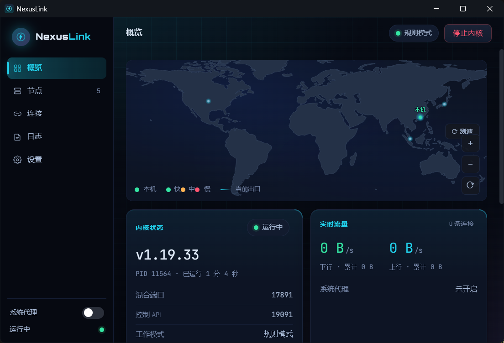
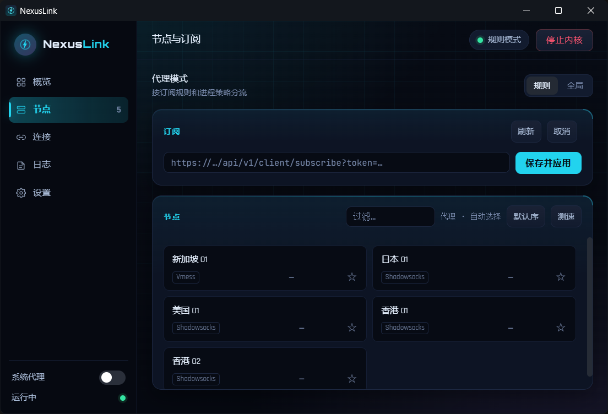
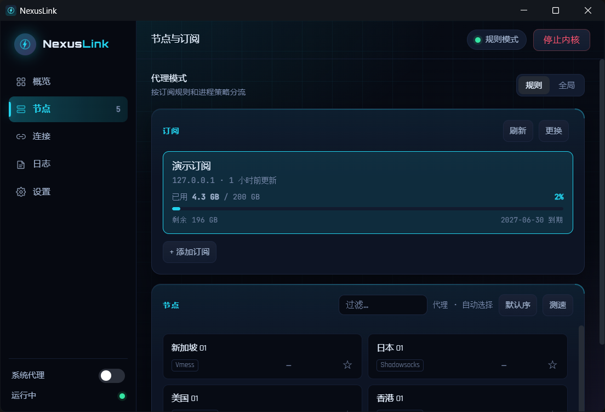
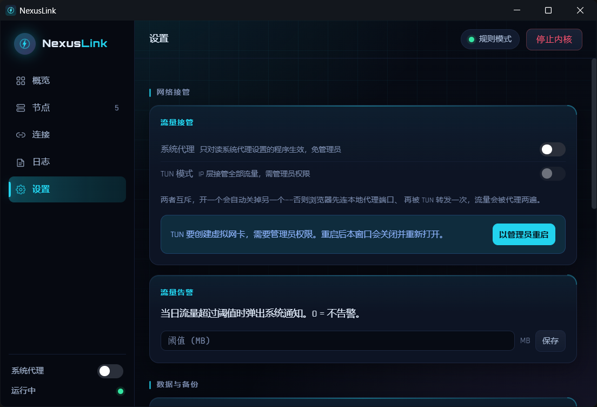
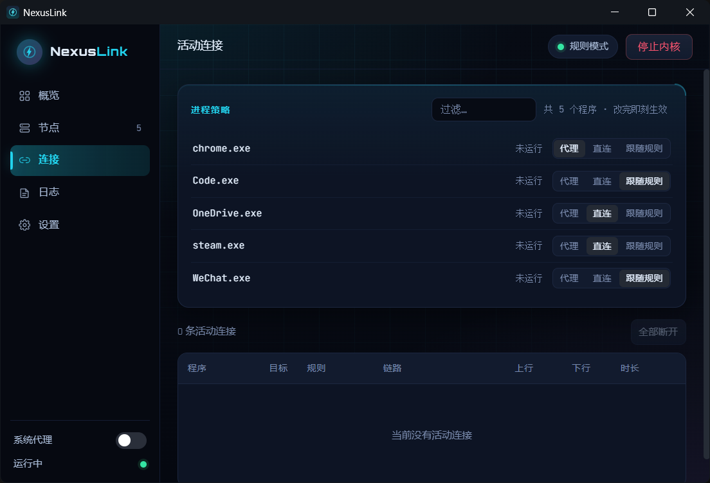
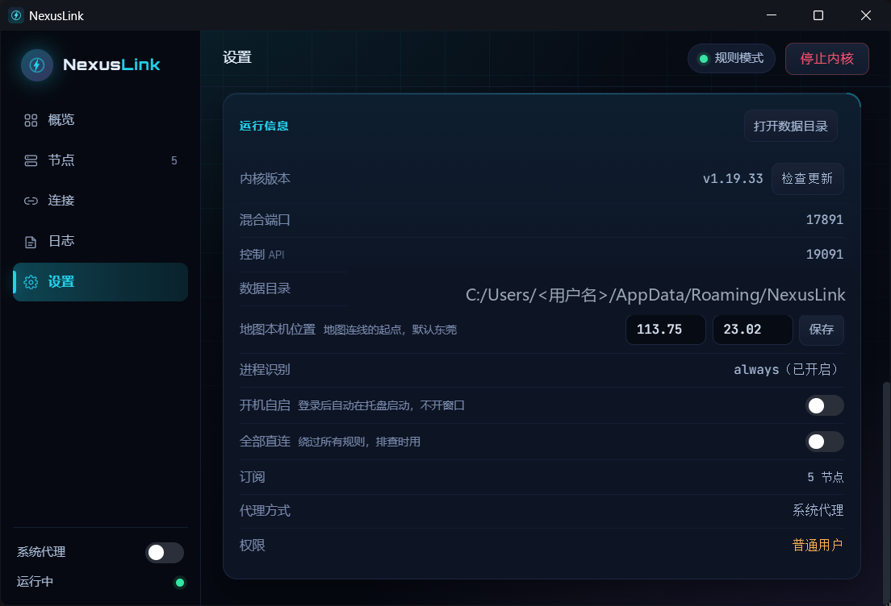
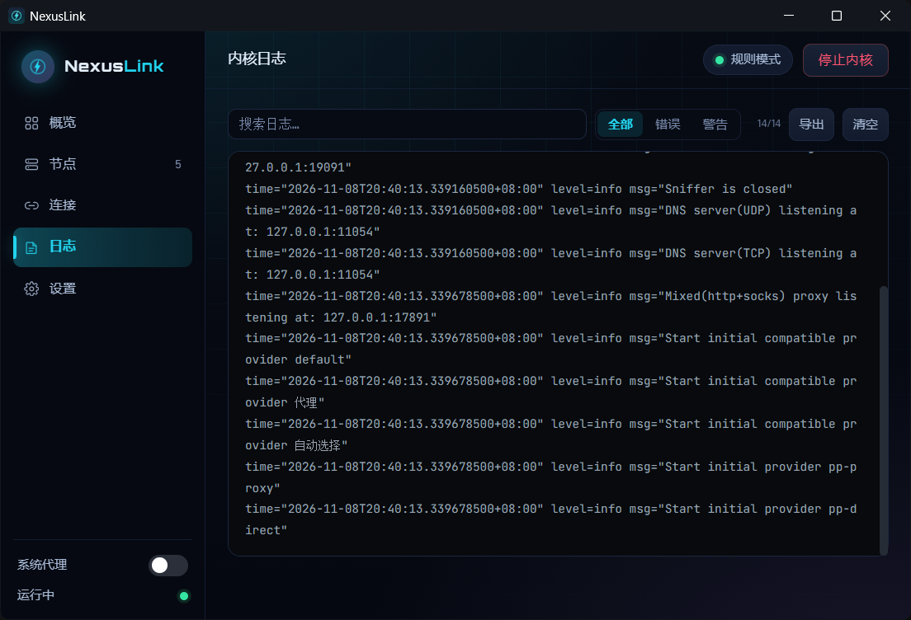

# 使用指导

从解压到跑起来的完整流程。截图基于 v1.0.0，演示数据为虚构节点，仅作界面示意。

## 目录

1. [首次启动](#1-首次启动)
2. [添加订阅](#2-添加订阅)
3. [选节点与代理模式](#3-选节点与代理模式)
4. [让流量进来：系统代理或 TUN](#4-让流量进来系统代理或-tun)
5. [按程序分流](#5-按程序分流)
6. [日常设置](#6-日常设置)
7. [看日志排障](#7-看日志排障)
8. [数据在哪、怎么卸载](#8-数据在哪怎么卸载)

---

## 1. 首次启动

便携版解压后双击 `NexusLink.exe` 即可，没有安装步骤。首次启动会把 mihomo 内核和
GeoIP/GeoSite 数据释放到数据目录（约 70MB，只做一次），然后自动拉起内核。



界面分三块：

- **左侧栏**：五个页面入口（概览 / 节点 / 连接 / 日志 / 设置）；底部是
  **系统代理开关**和运行状态灯。
- **顶栏**：当前页标题、代理模式标签、**停止/启动内核**按钮。
- **主区域**：随左侧切换。

概览页上，地图标出本机位置与当前出口；「内核状态」卡片能看到内核版本、
混合端口、控制 API、工作模式、当前节点 —— 报障时先把这张图发出来。

> 想改窗口大小直接拖，位置和大小下次启动会记住。

## 2. 添加订阅

切到「节点」页，点 **+ 添加订阅**，粘贴你的订阅链接，点 **保存并应用**：



拉取成功后，订阅卡片会显示用量与到期时间，下面是节点列表：



订阅卡片上的按钮：

| 按钮 | 作用 |
|---|---|
| **刷新** | 立即重新拉取订阅（不等自动更新） |
| **更换** | 换一个新的订阅链接 |
| **星标** | 收藏节点，收藏的排在前面 |

补充说明：

- **多个订阅可以并存**，点卡片切换当前生效的那个。
- **自动更新**默认开启，按订阅自带的更新周期拉取。
- 链接是 `https` 但证书是自签名时，卡片上会出现「跳过证书校验」的开关。
  **只有你确认这是自己的面板时才开**，并且随时可以点「恢复证书校验」关回去；
  跳过状态会一直有提示，不会悄悄生效。
- 节点名称旁边可以复制订阅链接，方便导到手机端客户端。

## 3. 选节点与代理模式

页面顶部是代理模式，两档：

- **规则**（推荐）：按订阅里的规则和下面的进程策略分流，国内直连、该走代理的才走。
- **全局**：忽略规则，所有流量都进主策略组。打不开某个站又懒得排查时用。


「节点」卡片里：

- **测速**：批量测所有节点的延迟；单个节点也可以单独测。
- **代理 · 自动选择**：选择器，决定当前实际走哪个节点/策略组。
- **默认序**：切换排序方式（延迟 / 名称 / 默认）。
- **过滤…**：节点多了以后按名字筛。

## 4. 让流量进来：系统代理或 TUN

不做这一步的话，浏览器不会走 NexusLink。两种接管方式，**互斥**：

| 方式 | 怎么开 | 适用 |
|---|---|---|
| **系统代理** | 左侧栏底部的开关，点一下即可 | 大多数情况；**不需要管理员** |
| **TUN** | 设置页 → 流量接管 → TUN 模式 | 要接管所有程序（包括不认系统代理的）；**需要管理员** |



要点：

- 系统代理**只对读系统代理设置的程序生效**。游戏客户端、部分命令行工具不认它，
  这时候才需要 TUN。
- 开 TUN 前得先以管理员身份运行（设置页有「以管理员重启」按钮，点了会自动重启窗口）。
  TUN 是在 IP 层接管全部流量，所以**不需要**再开系统代理，两者同时开流量会被代理两遍。
- TUN 要创建虚拟网卡，第一次会触发 UAC 提权提示。
- 侧栏的开关在 TUN 模式下会变成「TUN 接管中」的状态提示，点它直达设置页。

## 5. 按程序分流

这是 NexusLink 的核心能力。在「连接」页，每个程序可以单独指定策略：



三态的含义：

| 策略 | 效果 |
|---|---|
| **代理** | 这个程序的流量一律走代理 |
| **直连** | 一律直连，绕过规则（同步工具、游戏这样配） |
| **跟随规则** | 回到订阅规则，按域名/目标正常分流 |

- 列表里的程序来自实际捕获到的流量，**改完立刻生效**，不用重启内核。
- 上面的「过滤…」按进程名搜索；「改完即刻生效」提示旁边会显示程序总数。
- 下面是活动连接表：目标 / 命中的规则 / 链路 / 上下行 / 时长，
  可以单条断开，也可以「全部断开」。
- 更复杂的规则（按域名/IP）写在订阅里，或用设置页的「配置备份与规则」查看当前生效的规则。

## 6. 日常设置

设置页下半部分：



- **流量告警**：当日流量超阈值弹系统通知，填 0 表示不告警。
- **配置备份与规则**：导出订阅、进程规则等配置；查看当前生效的分流规则。
- **地图本机位置**：地图上连线的起点，默认东莞，可改成你的城市（经纬度）。
- **开机自启**：登录后自动在托盘启动，不开窗口。
- **全部直连**：一键绕过所有规则和进程策略，**排查时用**——怀疑代理本身有问题时打开它对比。
- **运行信息**：内核版本（可点「检查更新」从 GitHub 拉新版）、端口、数据目录、
  订阅数、代理方式、当前权限（普通用户 / 管理员）。

## 7. 看日志排障

「日志」页是内核的实时输出：



- **搜索日志…** 关键词过滤；**全部 / 错误 / 警告** 按级别过滤。
- **导出** 把当前日志存成文件；**清空** 只清显示，不影响磁盘。
- 常见报错定位：
  - `Failed to fetch` / `connection refused` —— 节点不可达，去节点页测速换节点。
  - `initial configuration error` —— 订阅内容不被内核接受，点订阅「刷新」或检查订阅源。
  - 没有任何输出 —— 内核没起来，看概览页「内核状态」和顶栏启动按钮。

## 8. 数据在哪、怎么卸载

所有数据都在一个目录里，删掉即卸载：

```
%APPDATA%\NexusLink\
├── config.yaml           # 由订阅生成的运行时配置
├── subs.json / sub-*.yaml # 订阅列表与各订阅原文
├── app-state.json        # 模式、TUN、窗口位置、本机坐标
├── process-rules.json    # 进程分流规则
├── cache.db              # 流量历史
└── bin\                  # 释放出来的内核
```

- 设置页「打开数据目录」按钮可以直接跳过去。
- **订阅链接、规则、流量历史只存本机，不上传。**
- 旧版本（ProxDeck）的数据会在首次启动时自动迁移。
- 卸载：托盘右键退出 → 删掉上面这个目录。没有注册表残留（开机自启的注册表项会随退出清理）。

---

## 常见问题

**开了系统代理但浏览器没走代理？**
先看概览页「系统代理」是不是「已开启」、内核是不是「运行中」；再看连接页里
浏览器进程是不是被设成了「直连」。

**TUN 打不开？**
必须以管理员身份运行。设置页会显示当前权限，普通用户状态下开关不可用，
点「以管理员重启」即可。

**订阅到期时间显示不对？**
订阅服务器返回的 `subscription-userinfo` 头要带 `expire`；没有的话会显示「永久」。
显示异常请先「刷新」订阅再看。

**换电脑/重装怎么迁移？**
把整个 `%APPDATA%\NexusLink` 目录拷过去即可，订阅、规则、历史全在里头。
